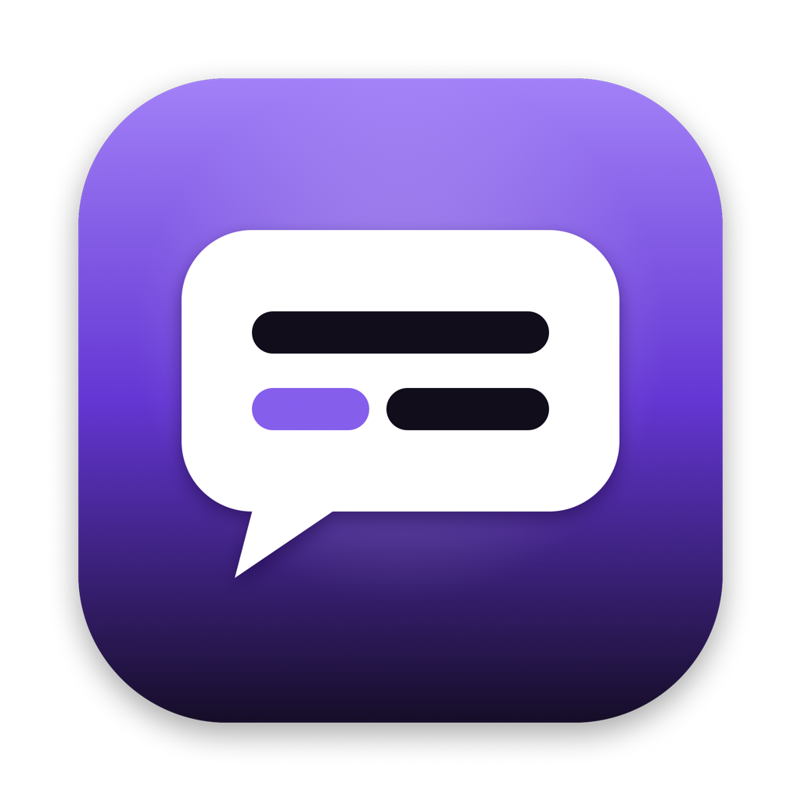
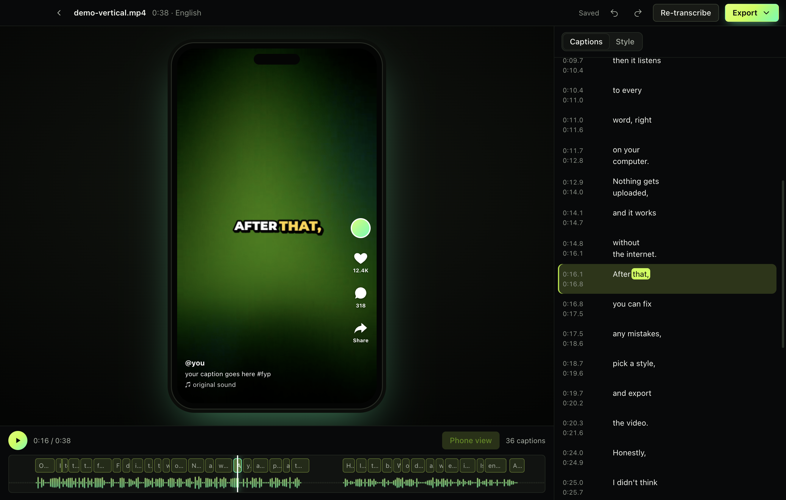

<p align="center">
  <a href="https://hollowbit.dev/captionshaper/"></a>
</p>

<h1 align="center">Captionshaper</h1>

<p align="center"><b>Free, offline auto-subtitles.</b></p>
<p align="center">Word-timed captions for any video, made on your own computer. Nothing is uploaded.</p>

<p align="center">
  <a href="https://github.com/hollowbit-dev/captionshaper/releases/latest"></a>
  
  
  <a href="LICENSE"></a>
</p>

<p align="center">
  <a href="https://hollowbit.dev/captionshaper/download.html"></a>
</p>

<p align="center"></p>

## What it does

Drop in a video. Captionshaper listens on your computer, writes every word with its timing, and splits it into captions that are easy to read. Fix anything it got wrong, pick a style, and export subtitles (SRT, VTT, ASS, TXT) or a video with the captions burned in, including word-by-word highlight for TikTok, Reels and Shorts.

Nothing is uploaded. The only download is the speech model, once.

## How it gets good captions

- **Speech recognition:** OpenAI Whisper (Large v3 Turbo by default) through whisper.cpp, on the GPU on Apple Silicon.
- **No captions over music or silence:** Silero voice activity detection finds speech; everything else is silenced before recognition, and any word outside speech is dropped.
- **Word timing:** token-level DTW timestamps, snapped to where the voice really starts and stops.
- **Line breaks:** captions are chosen by dynamic programming. Breaks prefer sentence and clause ends, avoid ending a line on "the", "a" or "to", never hold text over a long pause, and keep lines within the width of your video.
- **Punctuation:** language detection, then a short primer in that language, so clips don't come out in lowercase run-ons.

Accuracy check (`npm run accuracy`): 0.7% word error rate on English, Spanish and German test clips, captions within 0.14 s of the voice, no words over music or noise.

## Install

Get the installer from the [website](https://hollowbit.dev/captionshaper/download.html) or the [latest release](https://github.com/hollowbit-dev/captionshaper/releases/latest).

- **Mac (Apple Silicon):** open the .dmg and drag Captionshaper to Applications. The first time, right-click it and choose **Open**, because the app isn't signed yet.
- **Windows:** run the installer. If SmartScreen appears, click **More info**, then **Run anyway**.

With Homebrew:

```sh
brew tap hollowbit-dev/tap
brew trust hollowbit-dev/tap
brew install --cask captionshaper
```

## Develop

```
npm install
npm run bundle-whisper      # copies Homebrew's whisper.cpp into vendor/ (brew install whisper-cpp)
node scripts/fetch-ffmpeg.mjs darwin arm64
bash scripts/fetch-whisper-win.sh   # Windows build only
mkdir -p vendor/models && curl -L -o vendor/models/ggml-silero-v5.1.2.bin https://huggingface.co/ggml-org/whisper-vad/resolve/main/ggml-silero-v5.1.2.bin
npm start
```

Website: `npm run site` builds docs/ from site/.

Tests: `npm run test:engine` (no models needed), `npm test` (needs the Recommended model downloaded once through the app), `npm run accuracy`.

## More free apps from Hollowbit

- **[Melodyshaper](https://hollowbit.dev/melodyshaper/)**: hum a tune, make a song
- **[Clipshaper](https://hollowbit.dev/clipshaper/)**: long videos to short clips
- **[Lightshaper](https://hollowbit.dev/lightshaper/)**: free photo editor
- **[Fileshaper](https://hollowbit.dev/fileshaper/)**: compress, convert, sign PDFs
- **[Writeshaper](https://hollowbit.dev/writeshaper/)**: offline writing assistant
- **[Moveshaper](https://hollowbit.dev/moveshaper/)**: move to a new computer
- **[Diskshaper](https://hollowbit.dev/diskshaper/)**: clean up storage
- **[Startshaper](https://hollowbit.dev/startshaper/)**: find out why your PC is slow
- **[Fuseduo](https://fuseduo.com/)**: automate your Mac apps

## Licence

GPL-3.0-or-later. See [LICENSE](LICENSE) and [THIRD_PARTY_NOTICES.md](THIRD_PARTY_NOTICES.md).

---

<p align="center"><sub>Made by <a href="https://hollowbit.dev">Hollowbit Studio</a>. If Captionshaper helped you, a ⭐ helps other people find it.</sub></p>
