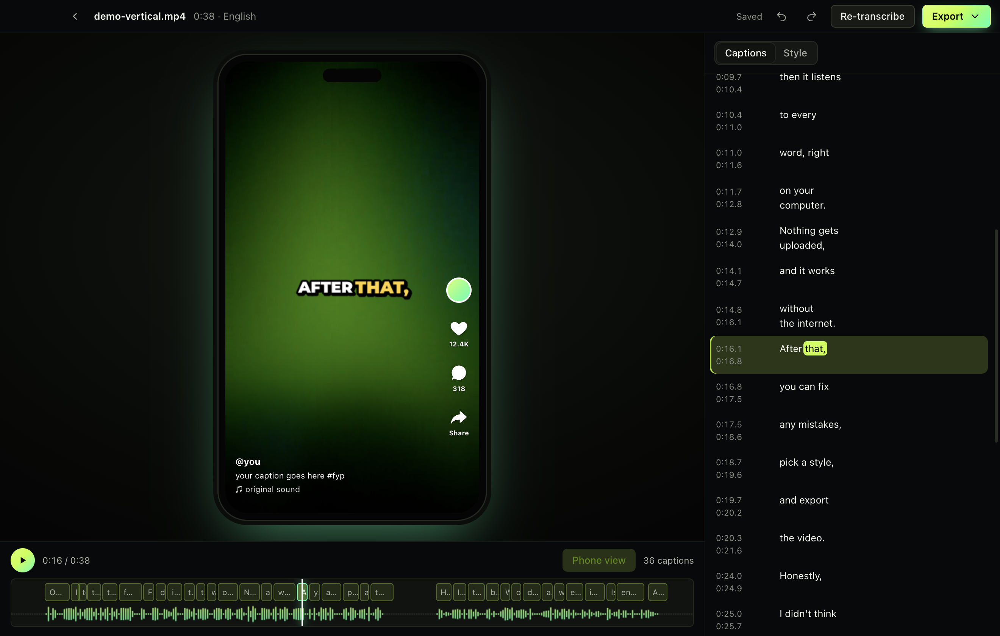

# Captionshaper

Free, offline auto-subtitles for Mac and Windows, by Hollowbit.

**[Download](https://captionshaper.app/download.html)** · [Website](https://captionshaper.app)



Drop in a video. Captionshaper listens on your computer, writes every word with its timing, and splits it into captions that are easy to read. Fix anything it got wrong, pick a style, and export subtitles (SRT, VTT, ASS, TXT) or a video with the captions burned in, including word-by-word highlight for TikTok, Reels and Shorts.

Nothing is uploaded. The only download is the speech model, once.

## How it gets good captions

- **Speech recognition:** OpenAI Whisper (Large v3 Turbo by default) through whisper.cpp, on the GPU on Apple Silicon.
- **No captions over music or silence:** Silero voice activity detection finds speech; everything else is silenced before recognition, and any word outside speech is dropped.
- **Word timing:** token-level DTW timestamps, snapped to where the voice really starts and stops.
- **Line breaks:** captions are chosen by dynamic programming. Breaks prefer sentence and clause ends, avoid ending a line on "the", "a" or "to", never hold text over a long pause, and keep lines within the width of your video.
- **Punctuation:** language detection, then a short primer in that language, so clips don't come out in lowercase run-ons.

Accuracy check (`npm run accuracy`): 0.7% word error rate on English, Spanish and German test clips, captions within 0.14 s of the voice, no words over music or noise.

## Develop

```
npm install
npm run bundle-whisper      # copies Homebrew's whisper.cpp into vendor/ (brew install whisper-cpp)
node scripts/fetch-ffmpeg.mjs darwin arm64
bash scripts/fetch-whisper-win.sh   # Windows build only
mkdir -p vendor/models && curl -L -o vendor/models/ggml-silero-v5.1.2.bin https://huggingface.co/ggml-org/whisper-vad/resolve/main/ggml-silero-v5.1.2.bin
npm start
```

Website: `npm run site` builds docs/ from site/.

Tests: `npm run test:engine` (no models needed), `npm test` (needs the Recommended model downloaded once through the app), `npm run accuracy`.

## Licence

GPL-3.0-or-later. See THIRD_PARTY_NOTICES.md.
